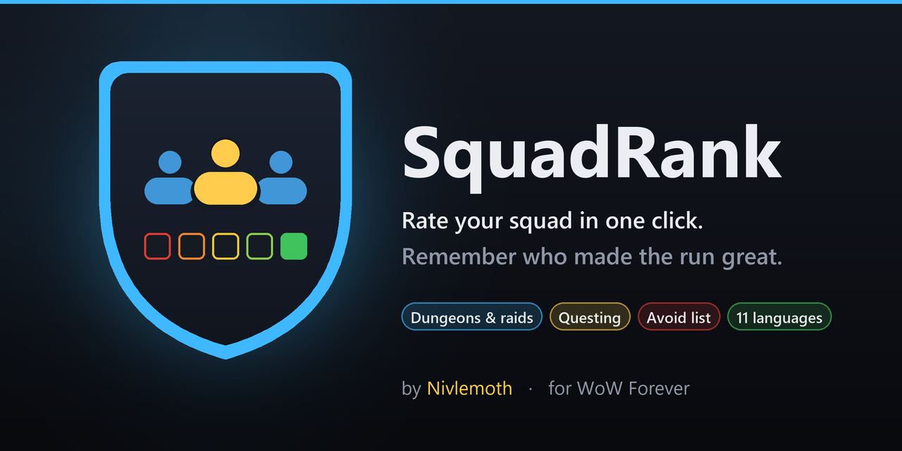
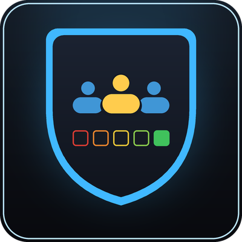

<p align="center">
  
</p>

<h1 align="center">🛡️ SquadRank</h1>

<p align="center">
  <b>Rate your squad in one click. Remember who made the run great.</b><br>
  A World of Warcraft add-on for <b>WoW Forever</b> (Interface 16001) · version <b>1.0.0-release</b>
</p>

<p align="center">
  🔒 100% local &nbsp;·&nbsp; ⚡ one-click ratings &nbsp;·&nbsp; 🌍 11 languages &nbsp;·&nbsp; 📦 zero libraries
</p>

---

## 📖 Contents

- [What it is](#-what-it-is)
- [How it works](#-how-it-works)
- [Features](#-features)
- [Private by design](#-private-by-design)
- [Installation](#-installation)
- [Commands](#-commands)
- [Languages](#-languages)
- [FAQ](#-faq)
- [Development](#%EF%B8%8F-development)
- [Project layout](#%EF%B8%8F-project-layout)
- [Documentation](#-documentation)
- [License](#%EF%B8%8F-license)
- [Support](#-support)

---

## 🎯 What it is

You group with dozens of players every week. Some carry the run, some vanish after the first boss, some
need on every item. **SquadRank remembers them for you**, so next time you know who you're grouping with.

## 🔄 How it works

1. 🎮 **Play.** Dungeon, raid, questing group, battleground or arena: SquadRank quietly notes who was
   there, which bosses went down, how many wipes, and which quests you finished together.
2. ⏳ **Rate when it suits you.** When the group breaks up, a small **"Rate your squad"** card waits at the
   top of your screen. No timer, never in combat.
3. 👆 **One click per player.** Every groupmate gets a card with five score buttons. Click a score and it's
   saved. Tags and a short note are optional.
4. 🔔 **Know who's joining.** When someone you rated joins a later group, a short pop-up shows their score,
   your tags and your note. On your avoid list? You get a 🚫 red warning with a sound.

## ✨ Features

| | Feature | Details |
|---|---|---|
| ⭐ | **One-click ratings** | Score 1 (awful) to 5 (great), with the role they played. |
| 🏷️ | **16 tags** | 8 positive (Great at role, Good communicator, Patient/helpful, Efficient, Fair with loot, Stayed to the end, Knows the dungeon, Led the group well) and 8 negative (Bad at role, Ninja looted, Needed off-spec loot, Left early, AFK, Toxic, Reckless pulls, Ignores mechanics). |
| 📝 | **Notes** | Up to 140 characters per rating. Never shared. |
| 🗺️ | **Every kind of group** | Questing, Open world, Dungeon, Raid, World raid, PvP and World PvP, each with its own label and filter. |
| ⚔️ | **PvP page** | Battlegrounds, arenas, world PvP and open-world raids live on their own page. A 40-player raid never floods your player list or asks you to rate 39 strangers. |
| 💀 | **Run details** | Bosses defeated, wipes, quests completed and progressed, and how long the group lasted. Hover any group to see it. |
| 🏅 | **Reputation** | Players become **Trusted**, **Mixed** or **Caution** from a recency-weighted average (older ratings count less). You choose how many ratings it takes. |
| 🚫 | **Avoid list** | Mark a player and you're warned with a sound when they join. They show in red everywhere. |
| 💬 | **Player tooltips** | Hover anyone you've rated to see their SquadRank score, or the avoid warning. |
| 📊 | **Stats page** | Groups and hours, bosses and quests, who you group with most, who you rated highest, groups by type. |
| 📤 | **Share a summary** | Opt-in. One line about a player to paste in chat. Your notes are never included. |
| ⏱️ | **No prompt for quick visits** | Dungeons left within 3 minutes (adjustable) don't ask for a rating. |
| 🪟 | **One clean window** | Rate, Players, Runs, PvP, Stats, Settings and About in one window with smooth animations. |
| 🧭 | **Minimap button** | Left-click opens, right-click opens Settings, drag to move. A gold dot pulses when players are waiting. Also in the Addon Compartment. |
| 🔊 | **Sounds** | For the rating card, join pop-ups and avoid warnings, with a switch to turn them off. |
| 🖱️ | **Right-click menu** | On a party member's frame: **Rate in SquadRank** and **Add to avoid list**. |

## 🔒 Private by design

- 🏠 **Everything stays on your computer.** SquadRank makes no network connections and has no
  addon-channel code. Nothing is sent, shared or uploaded.
- 💾 Ratings and notes live only in your own SavedVariables file.
- ✋ It never writes to Blizzard's own notes.
- ⚔️ It never reads or saves anything during combat. Every window, alert and pop-up hides when combat
  starts and comes back after.
- 🧹 The debug report contains counts only: no player names, realms, notes or IDs (names are scrubbed even
  from error messages).
- 🗑️ `/sr purge <name>` removes exactly that player; `/sr purge all` removes everything but your settings.

## 📥 Installation

### From CurseForge
Install **SquadRank** with the CurseForge app, or download the zip and follow the manual steps below.

### Manually
1. Close World of Warcraft (or stay at character selection).
2. Unzip so that this file exists:
   ```
   World of Warcraft\_forever_\Interface\AddOns\SquadRank\SquadRank.toc
   ```
   The folder must be named exactly `SquadRank`.
3. Start the game, click **AddOns** at character selection, and make sure SquadRank is ticked.
4. In game, type `/sr` to open the window. ✅

📁 Your data is saved in
`World of Warcraft\_forever_\WTF\Account\<ACCOUNT>\SavedVariables\SquadRank.lua`.
To uninstall, delete the `SquadRank` folder (and that file, to remove your data too).

More detail, including a `robocopy` one-liner for developers, is in [INSTALL.md](INSTALL.md).

## ⌨️ Commands

| Command | What it does |
|---|---|
| `/sr` | 🪟 Open or close the window |
| `/sr rate [name]` | ⭐ Rate a player, or your last group when no name is given |
| `/sr list [text]` | 📋 Print your saved players in chat |
| `/sr settings` | ⚙️ Open the settings |
| `/sr about` | ℹ️ Open the About page |
| `/sr minimap` | 🧭 Show or hide the minimap button |
| `/sr purge <name>` / `/sr purge all` | 🗑️ Delete one player, or all data (asks first) |
| `/sr debug` | 🐞 Open the debug report for copying |
| `/sr selftest` | 🧪 Check the game APIs SquadRank depends on |

`/squadrank` works in place of `/sr`.

## 🌍 Languages

SquadRank follows your game language automatically, with English for everything else:

🇺🇸 English · 🇩🇪 Deutsch · 🇫🇷 Français · 🇪🇸 Español (España) · 🇲🇽 Español (Latinoamérica) ·
🇧🇷 Português (Brasil) · 🇮🇹 Italiano · 🇷🇺 Русский · 🇰🇷 한국어 · 🇨🇳 简体中文 · 🇹🇼 繁體中文

- 💾 Your saved data is the same in every language; switching language changes only what you see.
- 🔢 Proper plural forms in each language ("1 rating", not "1 ratings").
- ✂️ Labels that don't fit end in "..." and show in full on hover.
- 🤝 Translations are machine-assisted. Native-speaker corrections are very welcome; see
  [docs/LOCALIZATION.md](docs/LOCALIZATION.md).

## ❓ FAQ

**👀 Does anyone else see my ratings?**
No. They are stored only on your computer. If you turn on sharing, you choose what to paste and where.

**🐢 Will it slow down my game?**
No. SquadRank works out of combat and keeps its data small. Old, unrated players are cleaned up
automatically (after 180 days, or 14 days for strangers met only in big PvP or world-raid groups).
Players you rated or avoid are never removed automatically.

**⚔️ Does it work in combat?**
It steps aside: the window and pop-ups hide in combat and come back afterwards.

**🐛 Something doesn't work.**
Type `/sr debug`, click in the box, press Ctrl+A then Ctrl+C, and paste the text in your report. It
contains no player names.

## 🛠️ Development

**Rules the code follows**

- 🌙 Lua 5.1 only, for the Forever client.
- 📦 Zero third-party libraries. One global (`SquadRank`) plus the two SavedVariables
  (`SquadRankDB`, `SquadRankDebug`).
- ✅ Every Blizzard API used is recorded in [docs/api-verified.md](docs/api-verified.md); unverified ones
  are checked by `/sr selftest`.
- 🧼 Player text is treated as untrusted input and sanitized.

**Checks**

```bash
bash tools/check.sh
```

This runs 🎨 [StyLua](https://github.com/JohnnyMorganz/StyLua) (formatting),
🔍 [luacheck](https://github.com/lunarmodules/luacheck) (lint, must report 0 warnings), and
🧪 the test suite (`spec/run.lua` with LuaJIT, or busted if installed). Tests run against a fake game
client in `spec/wowmock.lua`, including end-to-end "smoke" scenarios. Tool paths can be overridden with the
`STYLUA`, `LUACHECK` and `LUA` environment variables.

**Manual testing** in the game client follows [TESTING.md](TESTING.md).

## 🗂️ Project layout

```
SquadRank/
├── SquadRank.toc        📜 Add-on manifest (load order, version, icon)
├── LICENSE.txt          ⚖️ All Rights Reserved
├── Core/                ⚙️ Startup, events, slash commands, compat, debug, self-test
├── Data/                💾 Saved data: DB, players, ratings, runs, stats
├── Track/               🛰️ Group and run tracking
├── UI/                  🪟 Hub window, pages, controls, toasts, alert, minimap button
├── Locales/             🌍 Locale engine + 11 language files
├── Integrations/        🔌 Optional, read-only Recent Allies lookup (off by default)
├── Media/Icon.tga       🖼️ Logo (AddOns list, sidebar, About, minimap)
├── spec/                🧪 Tests and the fake WoW client
├── tools/check.sh       ✅ Format + lint + test
└── docs/                📚 Decisions, API notes, localization guide, references
```

Only `SquadRank.toc`, `LICENSE.txt`, `Media/` and the Lua folders are loaded by the game; docs, tests and
tools are not shipped.

## 📚 Documentation

| File | What's in it |
|---|---|
| [INSTALL.md](INSTALL.md) | 📥 Install, update, uninstall, where data lives |
| [TESTING.md](TESTING.md) | 🧪 Step-by-step in-game test plan |
| [RELEASE_NOTES.md](RELEASE_NOTES.md) | 📰 What changed in each version |
| [docs/DECISIONS.md](docs/DECISIONS.md) | 🧠 Why things work the way they do |
| [docs/api-verified.md](docs/api-verified.md) | ✅ Every game API used and how it was verified |
| [docs/LOCALIZATION.md](docs/LOCALIZATION.md) | 🌍 How to add or fix a translation |

## ⚖️ License

SquadRank is © 2026 Nivlemoth. **All Rights Reserved.** It's free to download and use, but please don't
re-upload or redistribute it. See [LICENSE.txt](LICENSE.txt).

It contains no third-party code, fonts, images or sounds; it only uses the game's own at runtime.
World of Warcraft® is a trademark of Blizzard Entertainment, Inc. SquadRank is a fan-made add-on and is not
affiliated with or endorsed by Blizzard.

## ☕ Support

SquadRank is free and always will be. If it saves you from a bad group, you can
[buy me a coffee](https://buymeacoffee.com/nivlemoth). Thank you! 💛

<p align="center">
  <br>
  <i>Made with ❤️ by Nivlemoth for WoW Forever.</i>
</p>
